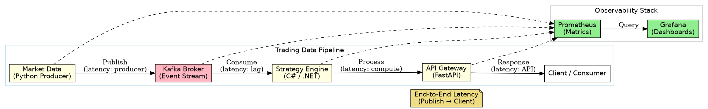

# Trading Observability Platform

[](https://github.com/dj-3dub/market-data-trading-platform/actions/workflows/ci.yml)

A **trading systems reliability and support lab** that models market data
distribution, service dependencies, latency-sensitive processing, and real-world
production incident response — instrumented from **both** the application layer
and the Linux kernel.

This project focuses on the **operational realities of supporting live trading
systems**: monitoring, alerting, troubleshooting, and recovery under
time-sensitive conditions. The goal is to model how systems behave under
real-time conditions — latency sensitivity, partial failure, and recovery —
rather than simply how they are deployed.

## Validated milestones

Priority 1 establishes a working observable pipeline and persistent infrastructure.
Priority 2 adds versioned multi-symbol ticks, a durable producer outbox,
transactional strategy checkpoints, duplicate suppression, quarantine and replay.
On the P720, both live Kafka checkpoint crash experiments recovered with one
restart each and no duplicate simulated BUY; all 19 application dashboard
queries and the final live pipeline check passed. Local suites passed 30 Python
and 18 C# tests. See [validation evidence and limits](docs/testing/priority-2-validation.md)
and the [Priority 2 runbook](docs/operations/priority-2.md).

Cockpit users can map Prometheus to another host port:

```bash
PROMETHEUS_PORT=9091 make priority2-acceptance
```

---

## Two Signal Sources, One Platform

The core idea of this repository is that **application metrics alone cannot
explain a latency spike**. So the platform runs two independent signal sources
into a single Prometheus and a single Grafana. The default stack collects
application metrics; kernel metrics require explicitly starting the optional
Wacker-Watch agent on a compatible Linux host:

| Signal | Source | What it tells you |
|--------|--------|-------------------|
| **Application** | Kafka → C# strategy engine → FastAPI | Latency percentiles, consumer lag, throughput, data freshness, error rates |
| **Kernel** | Wacker-Watch (eBPF `sched_switch`) | Off-CPU duration over 50 µs, grouped by thread command name |

When the strategy engine shows a p99 spike, the kernel signal adds context.
Off-CPU time includes intentional sleep, I/O blocking and runnable wait; it
cannot identify CPU contention or establish a root cause on its own.

```text
┌── Application signal ──────────────────┐   ┌── Kernel signal ──────────────┐
│  Market Data → Kafka → Strategy → API  │   │  Wacker-Watch (eBPF)          │
│  → Web Frontend                         │   │  sched_switch → off-CPU (ns)   │
└──────────────────┬──────────────────────┘   └──────────────┬────────────────┘
                   │                                            │
                   └──────────► Prometheus ◄────────────────────┘
                                    │
                                 Grafana
```

---

## Engineering Focus

This repository demonstrates:

- Event-driven market data ingestion and processing
- **End-to-end latency measurement and monitoring** from data generation to processing
- Service dependency awareness under failure
- Observability of real-time data flow with latency percentiles
- Detection of stale or degraded system states
- Production incident triage, troubleshooting, and recovery workflows under latency-sensitive conditions
- Infrastructure automation and reproducibility
- **Kernel-level observability with eBPF**, without modifying applications

---

## Architecture



Core pipeline:

```text
Market Data → Kafka → Strategy Engine → API → Consumers
```

Monitoring layer:

```text
All Services + eBPF Agent → Prometheus → Grafana
```

---

## Latency & Performance

This system models latency-sensitive event processing where delays in data
propagation can directly impact downstream decision-making.

### Metrics Tracked

**Application layer:**

- **End-to-end processing latency** (market data generation → strategy processing)
- **Kafka consumer lag**
- **Service response times**
- **Throughput under varying load conditions**

**Kernel layer:**

- **Off-CPU duration** (`wacker_watch_off_cpu_duration_ns`) — p50/p95/p99 of intervals greater than 50 µs
- Includes sleep, blocked I/O and runnable wait, in nanoseconds
- Grouped by thread command name (`comm`), not uniquely attributed to a process or container

### Measuring latency

Use the provisioned latency dashboard to measure p50/p95/p99 on your host.
`strategy_tick_latency_seconds` measures generation-to-strategy-processing
latency; API response time is measured separately. Results depend on host load
and injected incidents. The repository does not publish a reproducible benchmark.

### Key Observations

- Latency spikes correlate with **consumer lag** and **processing bottlenecks**
- Downstream services experience **delayed decision-making** under lag conditions
- System recovery time is critical to maintaining data freshness
- Off-CPU changes can be compared with application latency; additional runnable-wait and I/O evidence is needed to attribute causes

> In trading systems, stale data can be more dangerous than system downtime, as it may lead to incorrect decisions rather than no decisions.

---

## Data Flow

1. Market data service publishes simulated price data with timestamps
2. Kafka distributes events across consumers, enabling decoupled processing
3. Strategy engine consumes and processes data, measuring end-to-end latency
4. API exposes system state and processed data
5. Prometheus collects comprehensive metrics including latency histograms
6. Grafana visualizes system health and latency percentiles (p50/p95/p99)
7. Wacker-Watch measures filtered off-CPU duration in parallel, so kernel behaviour can be correlated with the above

---

## Core Components

### Strategy Engine (C# 14 / .NET 10)

Targets `net10.0`, which selects C# 14 by default. The Docker build uses the
.NET 10 SDK and ASP.NET Core 10 runtime; CI uses the .NET 10 SDK as well.
No host .NET installation is needed for the Docker workflow.

Consumes versioned simulated `FAKE`, `FAKE2`, and `FAKE3` ticks from Kafka and produces a BUY signal when the
price rises more than 0.1% from the previous tick; otherwise it reports HOLD.
Exports processing latency, freshness, throughput, and signal metrics.
Strategy state, accepted events, quarantined payloads and offsets are saved
in one local SQLite transaction before Kafka commits. Duplicate events do not
create another signal; sequence gaps block signals until ordered replay repairs
them. Stale ticks update analytical state without producing BUY signals. The lab
does not execute orders. See [Priority 2](docs/operations/priority-2.md).

### API Gateway (FastAPI)

Provides system visibility and exposes processed data.

### Wacker-Watch eBPF Agent (C + Python)

A kernel-space eBPF probe on `sched_switch` with a BCC userland collector. Measures off-CPU latency and exports it as Prometheus metrics with nanosecond-scale buckets. The Compose service runs as root with elevated capabilities and kernel filesystem mounts required to compile and load the probe. Native host execution uses `sudo`.

Full technical detail: [`agents/wacker-watch/README.md`](agents/wacker-watch/README.md)

### Python Automation & Monitoring Scripts

Python is used for lightweight operational tooling, including:

- Service health checks and validation
- **End-to-end latency measurement and alerting**
- Kafka lag detection and monitoring
- Failure detection automation and incident simulation

Scripts are located in: `scripts/`

### Kafka Broker

Event streaming backbone enabling decoupled communication.

### Observability Stack

Prometheus (metrics collection) and Grafana (visualization dashboards) provide comprehensive monitoring including:

- **End-to-End Latency Tracking**: Real-time measurement from market data generation to strategy processing
- **Latency Histograms**: `strategy_tick_latency_seconds` with p50/p95/p99 percentiles
- **Off-CPU Duration Histograms**: `wacker_watch_off_cpu_duration_ns` from the eBPF agent
- **Service Health Metrics**: Availability, throughput, and error rates
- **Kafka Consumer Lag**: Message backlog monitoring
- **Interactive Dashboards**: Pre-provisioned Grafana panels for application and kernel signals

---

## Failure Scenarios & Support Simulation

The following failure scenarios are intentionally introduced to simulate real-world production incidents:

- Kafka broker outage
- Consumer lag / backlog
- Strategy engine degradation
- API latency spikes
- Stale data conditions
- Partial system failure
- **Host CPU pressure** (a manual experiment; off-CPU duration alone does not prove contention)

---

## Getting Started

### Prerequisites
- Docker and Docker Compose
- Make (optional, for convenience commands)
- Python 3 and curl for host-side validation scripts
- For the eBPF agent only: a **native Linux host** with kernel headers (not WSL2)

### Quick Start
```bash
# Clone the repository
git clone https://github.com/dj-3dub/market-data-trading-platform.git
cd market-data-trading-platform

# Generate a private local Grafana password (make up also runs setup)
make setup

# Start the application and monitoring stack (optional eBPF agent excluded)
make up

# Wait for fresh strategy data and populated dashboard metrics
python3 scripts/verify-pipeline.py

# Check service health
make doctor

# Verify the full pipeline and exercise outage recovery
make test
make incident

# View logs
make logs
```

Follow the [local demo guide](docs/operations/demo.md) for the presentation
walkthrough, expected incident behaviour, API semantics, and recovery commands.
Python 3 and curl are required for the host-side validation scripts. The simulator
publishes one tick per second across three simulated symbols automatically; opening the frontend adds API
traffic and displays processed strategy signals.

The default stack starts 11 services: market data, Kafka, ZooKeeper, strategy
engine, API gateway, frontend, Prometheus, Grafana, Kafka exporter, Kafka UI,
and the reliability probe.
Without Make, run `python3 scripts/setup-local.py`, then
`docker compose up -d --build`.

On a cold start, Kafka UI may still be starting and Prometheus needs time to
collect samples before all checks pass. Run the pipeline verification above,
allow startup to finish, and retry health or smoke checks if necessary. Keep the
frontend open during the demo to generate API traffic; API latency panels can
show no data after five minutes without requests.

`make incident` deliberately pauses the strategy engine until its outage alert
fires (a bounded check), then resumes it and verifies recovery. Rehearse this before presenting an outage.
Alerts are visible in Prometheus; external notification delivery is not configured.

This is a local lab. Kafka records/committed offsets, ZooKeeper state, Grafana
state and Prometheus history use named volumes and are intended to survive
container recreation. Producer and strategy state use dedicated local SQLite volumes. Prometheus retains up
to 35 days. Removing volumes deletes the persisted lab data. Verify these
guarantees on your host with `make test-persistence`. Stop the default stack with
`make down` or `docker compose down`.

Published ports bind to `127.0.0.1` by default. For access from your P720 to
the Debian VM, use the SSH tunnel in the [demo guide](docs/operations/demo.md).
The [Priority 1 checklist](docs/operations/priority-1.md) covers upgrades,
persistence validation, credentials, and remaining runtime checks.

### Access Points
| Service | URL |
|---------|-----|
| Web Frontend | http://localhost:8082 |
| API Gateway | http://localhost:8000 |
| API Documentation | http://localhost:8000/docs |
| Wacker-Watch metrics (when enabled) | http://localhost:8001/metrics |
| Prometheus | http://localhost:9090 |
| Prometheus Alerts | http://localhost:9090/alerts |
| Grafana | http://localhost:3000 (admin; generated password in `.env`) |
| Kafka UI | http://localhost:8081 |

Every published port can be overridden with an environment variable, which is
useful when something else on the host already claims one:

```bash
WEB_PORT=8090 make up
```

> The web-frontend default is **8082** rather than the more common 8080, because
> 8080 is already claimed on the development host. Nothing depends on the value.

| Variable | Default | Service |
|----------|---------|---------|
| `WEB_PORT` | 8082 | web-frontend |
| `API_PORT` | 8000 | api-gateway |
| `AGENT_PORT` | 8001 | Wacker-Watch metrics |
| `PROMETHEUS_PORT` | 9090 | Prometheus |
| `GRAFANA_PORT` | 3000 | Grafana |
| `KAFKA_PORT` | 9092 | Kafka broker |
| `KAFKA_UI_PORT` | 8081 | Kafka UI |
| `KAFKA_EXPORTER_PORT` | 9308 | kafka-exporter |
| `MARKET_DATA_PORT` | 7001 | market-data |

### Running the eBPF agent

The agent is gated behind a compose profile so a default `make up` works on
hosts that cannot load eBPF. Start it explicitly:

```bash
# Container mode (requires a compatible host kernel and kernel headers)
make agent-up
```

Alternatively, install the host dependencies and run natively:

```bash
make agent-deps
make agent-run
```

Prefer `make agent-up`: Prometheus then reaches the agent over the internal
Compose network. Compose also publishes metrics on host port 8001, configurable
with `AGENT_PORT`. With `make agent-run`, Prometheus accesses port 8001 on the
host, which must be reachable from Docker.

Use one collector mode at a time. Both host and container scrape addresses are
configured; if both reach the same agent, aggregate event rates can double-count
it. Use one scrape address when measuring absolute event rates.

With `stress-ng` installed on the host, run `make agent-stress` in another
terminal to generate scheduler pressure. Stop the container agent with
`make agent-down`.

See [`agents/wacker-watch/README.md`](agents/wacker-watch/README.md) for kernel
requirements, BCC compatibility, and troubleshooting.

### Key Metrics to Monitor
- **End-to-End Latency**: View p50/p95/p99 percentiles in Grafana
- **Off-CPU Duration**: Compare filtered kernel off-CPU duration against application latency
- **Service Health**: All services report OK via health checks
- **Kafka Lag**: Monitor consumer backlog in real-time
- **Throughput**: Message processing rates across the pipeline

---

## Priority 2 correctness

`make priority2-acceptance` adds deterministic replay and isolated Kafka crash
experiments to the local acceptance workflow. It checks duplicate suppression,
sequence-gap recovery, stale-signal suppression and durable state across crashes
before/after the checkpoint. Read [the contract and P720 workflow](docs/operations/priority-2.md).

## Current Implementation Status

### Core Features
- **End-to-End Latency Measurement**: Implemented from market data generation to strategy processing
- **.NET 10 Strategy Engine**: C# 14 target with matching Docker and CI SDK configuration
- **eBPF Off-CPU Duration Agent**: Optional Wacker-Watch collector for off-CPU duration grouped by thread command name; requires a compatible host
- **Unified Metrics Pipeline**: One Prometheus configured for application metrics and the optional kernel signal
- **Real-Time Metrics**: Prometheus histograms with latency percentiles
- **Grafana Dashboards**: Provisioned via code for both application and kernel signals
- **Service Health Checks**: Automated validation of all components
- **Docker Compose Deployment**: Full containerized environment
- **CI Pipeline**: Compose validation, shellcheck, Python compile, eBPF syntax, dashboard schema, .NET build, Terraform validate
- **Incident Documentation**: Comprehensive failure scenario walkthroughs

### Local Demo Acceptance
- **Health validation**: `make doctor` checks containers, readiness, scrape targets, and dashboard provisioning.
- **Live data validation**: `make test` requires advancing strategy timestamps and all application dashboard queries to return finite data.
- **Incident validation**: `make incident` verifies consumer outage detection, a firing alert, positive backlog, and recovery, and writes traceable JSON evidence.
- **Persistence validation**: `make test-persistence` verifies stored data across stateful container recreation.
- **Portable CI**: Builds a fresh Compose stack and runs the local acceptance workflow; eBPF loading remains a native-host check.
- **Demo walkthrough**: [Run, observe, inject failure, and recover](docs/operations/demo.md).

Each scenario is paired with:
- Detection via monitoring and alerting
- Investigation using logs, metrics, and system tools
- Recovery actions to restore service

---

## Incident Response Workflows

This project models real-world incident response workflows expected in trading system support roles.

### Example: Consumer Lag Incident

Run `make incident` to exercise the implemented consumer outage scenario.

**Injection and detection**
- Pause the strategy container while market data continues publishing; wait for a firing outage alert
- Confirm API readiness returns HTTP 503
- Verify the Prometheus `TradingServiceDown` alert fires for the strategy engine
- Confirm Kafka consumer lag becomes positive

**Investigation**
- Observe consumer lag, freshness, and service availability in Grafana
- Inspect alerts in Prometheus and review service logs
- If the optional agent is running, compare application latency with kernel metrics

**Resolution**
- Unpause the strategy container and let it process the backlog

**Outcome**
- Verify fresh data resumes, consumer lag falls to 10 or less, and the outage alert clears
- Recovery latency percentiles can remain elevated while delayed ticks are still in the five-minute measurement window

## Observability Strategy

Key signals tracked:

- End-to-end latency
- Message throughput
- Consumer lag
- Data freshness
- Error rate
- Restart frequency
- **Filtered off-CPU duration**

---

## Operational Playbooks

- Incident simulations (`docs/incidents/`)
- Recovery runbooks (`docs/operations/`)
- Troubleshooting workflows
- Failure injection planning
- Validation checklists

---

## Incident Reports

Detailed incident simulations and response workflows:

- [Kafka Consumer Lag](docs/incidents/kafka-lag.md)
- [Service Crash](docs/incidents/service-crash.md)
- [Latency Spike](docs/incidents/latency-spike.md)
- [Kafka Broker Outage](docs/incidents/kafka-broker-outage.md)
- [API Gateway Latency Spike](docs/incidents/api-gateway-latency-spike.md)
- [Strategy Engine Unhealthy](docs/incidents/strategy-engine-unhealthy.md)

---

## Observability

Observability is treated as a first-class component of the system.

Dashboards and datasources are provisioned via code to ensure:
- reproducibility across environments
- zero manual configuration
- consistent visibility into system behavior

Dashboards are defined in `monitoring/grafana/dashboards/` and are provisioned by
`monitoring/grafana/provisioning/dashboards/dashboards.yml`:

| Dashboard | Signal |
|-----------|--------|
| `trading-platform-dashboard.json` | Application latency, lag, throughput, freshness |
| `trading-overview.json` | High-level platform health |
| `off-cpu-dashboard.json` | Filtered off-CPU percentiles and distribution |

---

## Simulated On-Call Workflow

This lab models the workflow of a trading systems support engineer:

1. Alert triggered (latency, lag, or failure)
2. Investigate using dashboards, logs, and system tools
3. Identify root cause — application or host
4. Execute recovery (restart, scale, isolate)
5. Validate system stability
6. Document incident and preventative improvements

## Project Structure

```text
.
├── .github/          # CI/CD workflows
├── agents/           # Kernel-level signal sources
│   └── wacker-watch/ # eBPF off-CPU duration agent (C probe + BCC userland)
├── docs/             # Architecture, operations, incidents, testing, resume
├── infra/            # Terraform (AWS ECS/Fargate)
├── monitoring/       # Prometheus + Grafana configuration and dashboards
├── scripts/          # Helper, diagnostic, and smoke-test scripts
├── services/         # Core application services (market data, strategy, API, frontend)
├── tools/            # Kafka utilities and supporting tools
├── .gitignore
├── docker-compose.yml
├── Makefile
└── README.md
```

The `services/` directory contains the application components that simulate a trading-style execution environment. The `agents/` directory contains the kernel-level instrumentation that observes the host those services run on.

---

## Linux-Based Troubleshooting

Operational troubleshooting is performed using standard Linux tools:

- Process inspection (`ps`, `top`, `htop`)
- Network diagnostics (`ss`, `netstat`, `lsof`)
- Log analysis (`journalctl`, application logs)
- Service management (`systemctl`)
- Kernel-level tracing (`bpftrace`, `perf`, BCC tools)

---

## Reliability Engineering Focus

The [reliability foundation](docs/reliability/README.md) adds provisional 30-day
SLOs, error-budget and burn-rate rules, a Grafana reliability dashboard,
independent freshness probing, deterministic Python/.NET tests, automated
consumer/producer/broker outages, restart/malformed-message/scrape-loss exercises,
and retained CI diagnostics.

Start with `make test-rules`, `make test-unit`, and `make test-failures`.
The [managed AWS environment](infra/terraform/envs/aws-managed/README.md) defines
Fargate, MSK, AMP and Managed Grafana with TLS ingress and service discovery.

This project is designed to explore:

- System behavior under failure
- Dependency-aware debugging
- Latency and data flow analysis
- Attributing latency to application code vs. host kernel behaviour
- Recovery workflows

---

## Beyond the Local Demo

The local demo includes latency instrumentation, consumer lag dashboards,
synthetic pipeline checks, and an automated consumer outage exercise. Further work:

- Network degradation simulation
- Distributed tracing (OpenTelemetry)
- Compare application latency percentiles with off-CPU measurements and supporting host evidence
- Alert notification delivery and durable state for longer-running deployments

---

## Design Philosophy

This project emphasizes understanding system behavior under real-world conditions,
including latency sensitivity, partial failures, and recovery workflows.

The goal is not just to deploy services, but to observe, debug, and improve them
under stress — at every layer the system runs on.

---

## Author

Tim Heverin
Infrastructure / Platform Engineering
Chicago, IL
